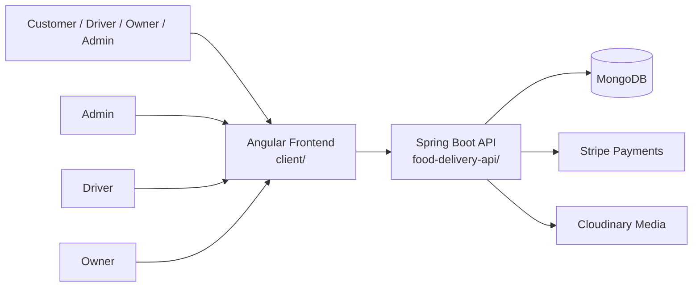
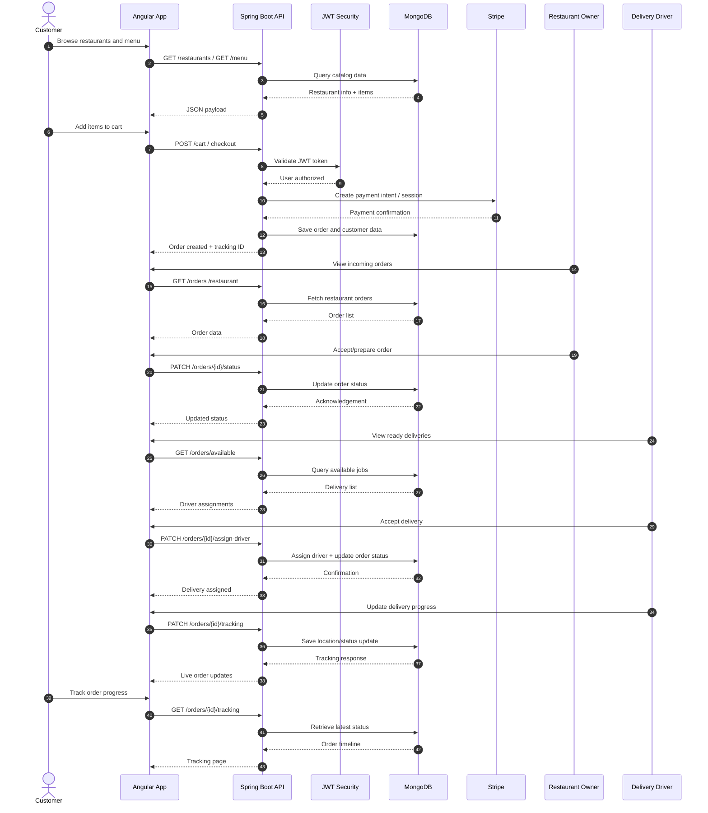

# Food Delivery App

A full-stack food delivery platform that connects customers, restaurants, delivery drivers, and administrators in a single ecosystem. The application is built with an Angular client for the user experience and a Spring Boot backend with MongoDB for persistence, authentication, order processing, and payments.

## Overview

This project simulates a real-world food delivery system where:

- Customers can browse restaurants, add meals to a cart, place orders, and track delivery status.
- Restaurant owners can manage menus, view incoming orders, and update their restaurant details.
- Delivery drivers can accept, process, and update assigned deliveries.
- Admins can oversee platform operations and manage system access.
- The application uses JWT-based authentication, Stripe for payments, and Cloudinary for media uploads.

## Architecture

### High-level system design



### End-to-end order flow



## Features

### Customer experience
- Browse restaurants and menus
- View restaurant details and dish information
- Add items to cart and manage quantities
- Place checkout orders securely
- Track delivery progress in real time
- Review order history and status

### Restaurant owner tools
- Manage restaurant profile and menu items
- View incoming customer orders
- Accept or update order status
- Monitor fulfillment workflow

### Delivery driver portal
- See available and assigned orders
- Accept deliveries
- Update progress while en route
- Manage completion and delivery history

### Admin dashboard
- Manage operations across the platform
- Monitor users, restaurants, and orders
- Control access and permissions

### Platform capabilities
- Role-based authentication and authorization
- JWT security
- Stripe payment integration
- Cloudinary image uploads
- Swagger/OpenAPI API documentation
- Docker-based local infrastructure

## Tech stack

### Frontend
- Angular 18
- TypeScript
- Tailwind CSS
- RxJS
- Lucide Angular icons

### Backend
- Java 17
- Spring Boot 3
- Spring Security
- Spring Validation
- JWT authentication
- MongoDB
- Swagger / OpenAPI

### Integrations
- Stripe payment processing
- Cloudinary media storage
- Docker and Docker Compose
- Mongo Express for database inspection

## Repository structure

```text
Food-Delivery-App/
├── client/                     # Angular frontend
│   ├── src/                   # Application code, routes, components, services
│   ├── package.json           # Frontend dependencies and scripts
│   ├── angular.json           # Angular project configuration
│   ├── Dockerfile             # Frontend container config
│   └── README.md             # Frontend-specific notes
├── food-delivery-api/         # Spring Boot backend
│   ├── src/main/java/         # Application source code
│   ├── src/main/resources/   # Config files and app resources
│   ├── pom.xml               # Maven dependencies and build config
│   ├── Dockerfile             # Backend container config
│   └── mvnw                  # Maven wrapper
├── scripts/                   # Utility scripts
├── docker-compose.yml         # Local services setup
├── docker-compose.prod.yml    # Production deployment compose file
├── .env.example              # Shared environment template
├── README.md                 # Main project documentation
├── BACKEND-ENDPOINT-INVENTORY.md
├── FRONTEND-BACKEND-LIMITATIONS.md
├── PRODUCTION-DEPLOYMENT.md
└── Caddyfile
```

## How the app works

The application follows a classic full-stack client-server design:

1. The Angular frontend renders the customer, restaurant, driver, and admin experiences.
2. Users authenticate through JWT-based login or registration.
3. The Spring Boot API validates tokens, enforces role-based permissions, and processes business logic.
4. MongoDB stores users, orders, restaurants, menu items, and tracking state.
5. Payments are processed securely through Stripe before an order is confirmed.
6. Restaurant owners and delivery drivers interact through dedicated views that read and update order status.
7. Customers can track their order until it reaches completion.

## Prerequisites

Make sure you have:

- Node.js 18+
- npm
- Java 17+
- Maven
- Docker and Docker Compose
- Git

## Environment configuration

Create your environment file from the example:

```bash
cp .env.example .env
```

You can also configure the backend-specific environment values:

```bash
cp food-delivery-api/.env.example food-delivery-api/.env
```

### Typical environment variables used by the app

| Variable | Purpose |
| --- | --- |
| JWT secret | Used for signing and validating user tokens |
| Stripe API key | Payment processing |
| Stripe webhook secret | Webhook verification |
| Cloudinary credentials | Media upload integration |
| MongoDB connection settings | Database access |

## Running the application

### Option 1: Run with Docker Compose

From the repository root:

```bash
docker compose up --build
```

This starts the main application services, including:

- MongoDB
- Mongo Express
- Spring Boot API

### Option 2: Run backend manually

```bash
cd food-delivery-api
./mvnw clean install
./mvnw spring-boot:run
```

### Option 3: Run frontend manually

```bash
cd client
npm install
npm start
```

## Default local URLs

- Frontend: http://localhost:4200
- Backend API: http://localhost:8081
- Swagger UI: http://localhost:8081/swagger-ui.html
- Mongo Express: http://localhost:8082

## Useful commands

### Frontend

```bash
cd client
npm install
npm run build
npm test
```

### Backend

```bash
cd food-delivery-api
./mvnw test
./mvnw package
./mvnw spring-boot:run
```

## Swagger / API documentation

The project includes Springdoc OpenAPI support. After starting the backend, open:

```text
http://localhost:8081/swagger-ui.html
```

This gives you a browser-based API explorer to test endpoints for auth, restaurants, orders, drivers, and admin actions.

## Security model

The backend enforces user access through Spring Security and JWT. Each role has different permissions:

- Customer: browse and buy food, track orders
- Restaurant owner: manage restaurant and menu, process orders
- Delivery driver: accept and complete deliveries
- Admin: full platform oversight

Role checks are enforced both in the backend and in the Angular routing layer using guards.

## Production notes

The repository includes production deployment files and examples for:

- Docker Compose production setup
- Caddy reverse proxy configuration
- Environment-specific configuration for deployments

See:
- `docker-compose.prod.yml`
- `Caddyfile`
- `PRODUCTION-DEPLOYMENT.md`

## Contributing

Contributions are welcome. If you want to improve the project:

1. Fork the repository
2. Create a feature branch
3. Make your changes
4. Open a pull request with a clear summary of the update

## Contact

For questions or collaboration, use the repository issues or reach out through the project owner profile.

## Summary

This repository is a realistic restaurant and delivery platform built as a full-stack JavaScript/TypeScript + Java application. It demonstrates how a modern app can combine:

- SPA front-end routing and dashboards
- secure REST API development
- database persistence with MongoDB
- role-based authorization
- payment integration
- deployment-ready Docker configuration

It is a good example of a complete, end-to-end service-oriented application architecture.
